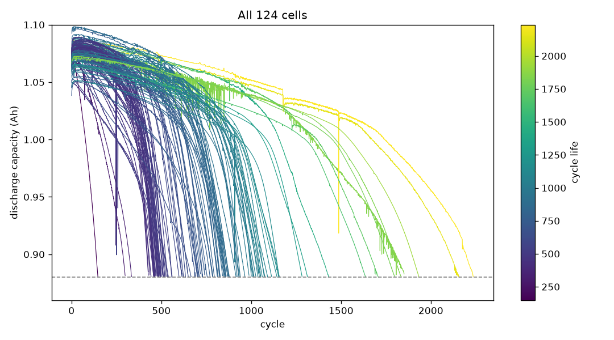

# battery-cycle-life

Predicting how many charge cycles a lithium-ion cell will last, using only its first 100 cycles.

The data comes from Severson et al. (2019), "Data-driven prediction of battery cycle life before capacity degradation", Nature Energy. The three batch files hold 140 LFP/graphite cells (A123 APR18650M1A, 1.1 Ah), each charged with a different fast-charging policy until it lost 20% of its capacity.



This is work in progress. The data is cleaned and explored; no models yet.

## Data so far

The paper uses 124 of the 140 cells. Notebook 04 gets to the same 124:

- 5 batch 1 cells kept cycling in batch 2, so their batch 2 cycles are appended to them. Their lifetimes go up from about 1,200 to as much as 2,237 cycles.
- 16 cells are dropped: the 5 duplicates from that merge, 5 cells that never reached 80% capacity, 2 that were still above 80% after 2,000 cycles, and 4 that the paper calls noisy. I could only see the noise in one of those 4, but I drop all of them so the results stay comparable.
- Glitches (zero resistance, paused charges, impossible capacities) become missing values, and cycles after end of life are cut.

That leaves 41 training cells, 43 primary test cells and 40 cells in a later batch, the same split as the paper.

Capacity on its own says little about lifetime at cycle 100. Most cells still look the same at that point, and 81% of them have slightly more capacity than at cycle 2 (notebook 05).

## Setup

Python 3.13:

```bash
python3 -m venv .venv
source .venv/bin/activate
pip install -r requirements.txt
./scripts/download_data.sh
```

The download script fetches the three batches from data.matr.io (about 8.3 GB) into `data/raw/`, which git ignores.

## Layout

- `notebooks/` exploration, in the order I did it
- `src/` code the notebooks share
- `reports/figures/` saved plots
- `scripts/` data download
