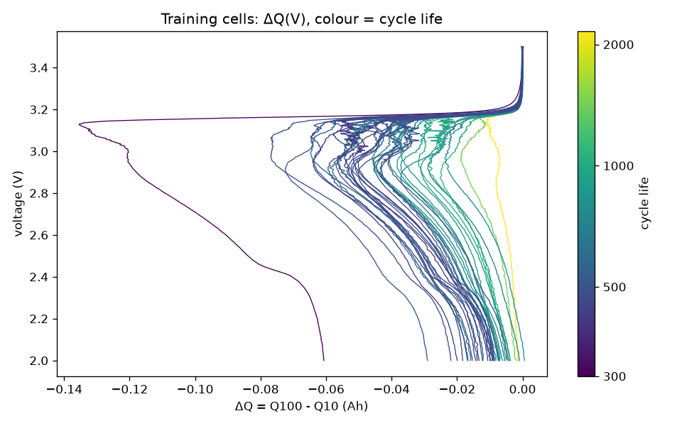
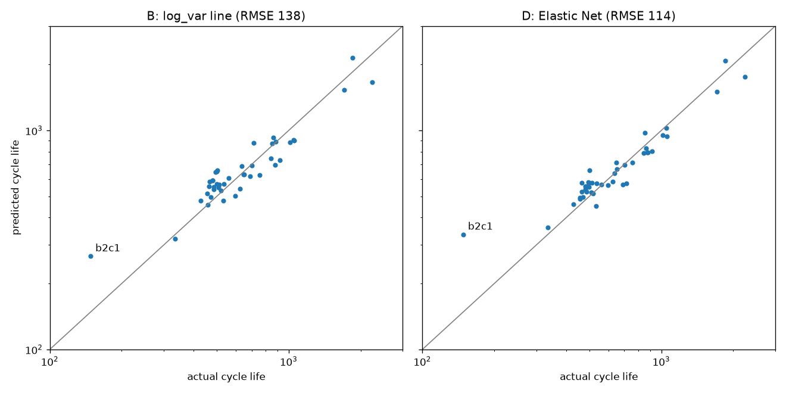
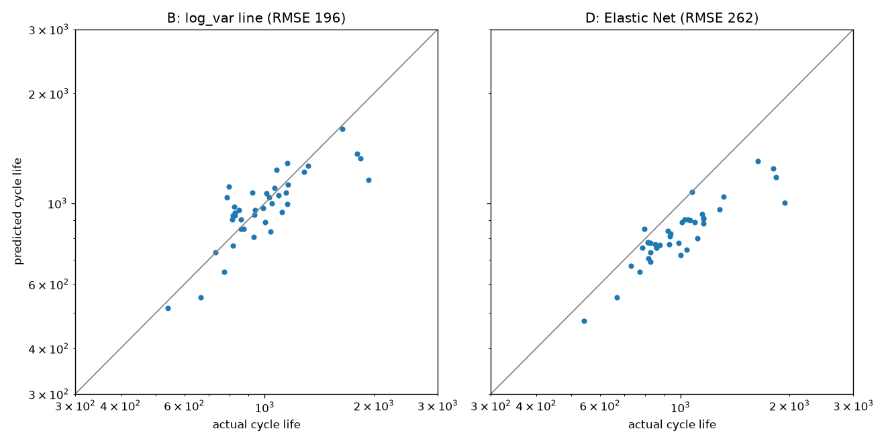

# battery-cycle-life

Predicting how many charge cycles a lithium-ion cell will last, using only its first 100 cycles.

The data comes from Severson et al. (2019), "Data-driven prediction of battery cycle life before capacity degradation", Nature Energy. The three batch files hold 140 LFP/graphite cells (A123 APR18650M1A, 1.1 Ah), each charged with a different fast-charging policy until it lost 20% of its capacity.


The modelling is done. The paper's simplest model is reproduced, a second model with a few more features is chosen by cross-validation, and both are scored on the primary test set and, once, on a batch that was cycled a year later. The short version: the bigger model wins on the first test set and loses on the later batch. A small demo app is still to come.

## Data so far

The paper uses 124 of the 140 cells. Notebook 04 gets to the same 124:

- 5 batch 1 cells kept cycling in batch 2, so their batch 2 cycles are appended to them. Their lifetimes go up from about 1,200 to as much as 2,237 cycles.
- 16 cells are dropped: the 5 duplicates from that merge, 5 cells that never reached 80% capacity, 2 that were still above 80% after 2,000 cycles, and 4 that the paper calls noisy. I could only see the noise in one of those 4, but I drop all of them so the results stay comparable.
- Glitches (zero resistance, paused charges, impossible capacities) become missing values, and cycles after end of life are cut.

That leaves 41 training cells, 43 primary test cells and 40 cells in a later batch, the same split as the paper.

Capacity on its own says little about lifetime at cycle 100. Most cells still look the same at that point, and 81% of them have slightly more capacity than at cycle 2 (notebook 05).

## First model: ΔQ(V)

The paper's key feature is ΔQ(V): the discharge curve at cycle 100 minus the one at cycle 10, on a fixed voltage grid. Cells that die early already show a deeper, wider dip in this curve, even when their capacity still looks fine.



One number per cell, log10 of the variance of ΔQ, has a correlation of -0.90 with log10 cycle life on the training cells. A straight line through it (notebook 06):

| Model | Train RMSE | Primary test RMSE | Primary test MAPE |
|---|---|---|---|
| Predict the mean life | 323 cycles | 393 cycles | 39.5% |
| log10 var(ΔQ), linear | 104 cycles | 138 cycles | 14.7% |
| Paper, same model | | 138 cycles | |

The test set has only 43 cells, so the 138 isn't precise: resampling them gives a 95% range of 92 to 191 cycles. The paper leaves the shortest-lived test cell (b2c1) out; without it the result is 138.3, so the match holds either way.

Most of the remaining error comes from three test cells that live over 1,700 cycles. Only one training cell lives that long, so the model is extrapolating there. The later batch is kept aside until the final test.

## Second model: a few more features

Five simple features from the per-cycle summary are added to log10 var(ΔQ): capacity at cycle 2, the early rise in capacity, the change in resistance, the charge time of the first cycles and the mean temperature (notebook 07). A test checks that none of them reads anything after cycle 100.

The model was picked on the training cells only, with 5-fold cross-validation repeated 20 times (notebook 08). An Elastic Net on all six features came out best. A curved version of the first model did badly, because its prediction runs away for the longest-lived cell.

| Model | CV RMSE (training cells) | Primary test RMSE | Primary test MAPE |
|---|---|---|---|
| log10 var(ΔQ), linear | 108 cycles | 138 cycles | 14.7% |
| log10 var(ΔQ), curved | 170 cycles | not scored | |
| Elastic Net, 6 features | 82 cycles | 114 cycles | 12.8% |

On the test set the Elastic Net is 24 cycles better than the line (notebook 09). Resampling the test cells puts that difference between 8 and 36 cycles, and the Elastic Net comes out ahead in 99.8% of the resamples. It keeps four of the six features and sets resistance change and temperature to zero.



It still struggles with the same cells as the first model. The three test cells above 1,500 cycles have an RMSE of 329, against 76 for the other 40. And b2c1, which dies at 148 cycles, is predicted at 335.

## How early can it predict?

The same two models, given only the first 20, 40, 60, 80 or 100 cycles (notebook 10):


In cross-validation the error falls until about 60 cycles and then stays flat: the Elastic Net is at 85 cycles with 60 cycles of data and at 82 with 100. Before that, ΔQ hasn't built up enough. After 20 cycles the model ignores it and mostly guesses from the charge time.

The primary test set looks worse at 60 and 80 cycles (187 and 171), and almost all of that is one long-lived cell, b1c0, predicted 830 to 900 cycles too long. Its ΔQ variance at that point is lower than any training cell's. On the other 40 test cells the error is 76, 72 and 76 cycles at 60, 80 and 100 cycles.

So 60 cycles look like enough for typical cells, and not for the ones that end up living very long. With three such cells in the test set, that's a pattern to keep in mind, not a firm result.

## Final test: the later batch

Batch 3 was cycled about a year after the others, with a changed setup and mostly different charging policies. Both models were fixed before they were scored on it, once (notebook 11).

| Model (RMSE in cycles) | Train | Primary test | Later batch |
|---|---|---|---|
| Predict the mean life | 323 | 393 | 470 |
| log10 var(ΔQ), linear | 104 | 138 | 196 |
| Elastic Net, 6 features | 76 | 114 | 262 |
| Paper, variance model | | 138 | 196 |
| Paper, full model | | 100 | 214 |

On the later batch the order flips. The Elastic Net is 66 cycles worse than the one-feature line (95% range of the difference: 37 to 93), and it predicts 39 of the 40 cells too short. The paper's own bigger model shows the same flip.

The reason is that this batch looks different in the extra features. All 40 cells start with less capacity than the median training cell, and 36 of them charge in under 10.5 minutes, which in batches 1 and 2 went with a short life (median 489 cycles). Here the median life is 964. The Elastic Net learned those links from batches 1 and 2 and they don't hold in batch 3. The ΔQ feature carries over much better.



Cross-validation didn't catch this, because every fold came from batches 1 and 2. I left both models as they were. For new cells from the same setup the Elastic Net is the better one, and for cells from an unknown setup I would use the line.

## Limitations

- Cells that never reached 80% capacity are left out, because their lifetime is unknown. That includes the two longest-running cells of the later batch, so the data has no very long-lived cells that were still going when the test ended.
- Four later-batch cells are dropped only because the paper calls them noisy. Only one of them looks noisy in my checks.
- The later batch was run with a changed test setup ("newstructure" in the policy names). Its cells live longer, their charge time barely changes from cycle to cycle, their resistance is lower, and only 1 of its 8 charging policies was used in batches 1 and 2 (notebook 05). A model trained on batches 1 and 2 is likely to do worse there.
- The overview plots in notebook 05 use all cells, test cells included. Model features are chosen on the training cells only.
- With 43 test cells, differences of less than about 50 cycles between models can't be trusted from the test set alone, so models are compared with cross-validation on the training cells.
- That cross-validation only uses batches 1 and 2, so it says nothing about a new batch. A check that holds out a whole batch at a time is missing.

## Setup

Python 3.13:

```bash
python3.13 -m venv .venv
source .venv/bin/activate
pip install -r requirements.txt
./scripts/download_data.sh
```

The download script fetches the three batches from data.matr.io (about 8.3 GB) into `data/raw/`, which git ignores. Then run the notebooks in order, 01 to 11. Most of them save tables in `data/` that the later ones read.

The tests check that no feature uses data from after the cycles it is allowed to see, and that the error measures and the model recipe behave as expected. They use made-up data, so they run without the download:

```bash
pytest
```

## Layout

- `notebooks/` exploration, in the order I did it
- `src/` code the notebooks share: reading the raw files (`load.py`), the features (`features.py`), the model recipe and error measures (`models.py`), and the paper's split (`split.py`)
- `tests/` checks on the features and the model code
- `reports/figures/` saved plots
- `scripts/` data download

## Data and credits

- Data: Severson, Attia et al., "Data-driven prediction of battery cycle life before capacity degradation", Nature Energy 4, 383-391 (2019). Downloaded from data.matr.io; check the terms there before reusing it.
- Which cells to merge and drop follows the authors' data loading notebook (github.com/rdbraatz/data-driven-prediction-of-battery-cycle-life-before-capacity-degradation).
- The train and test cell lists in `src/split.py` are taken from Microsoft's BatteryML (MIT license).
