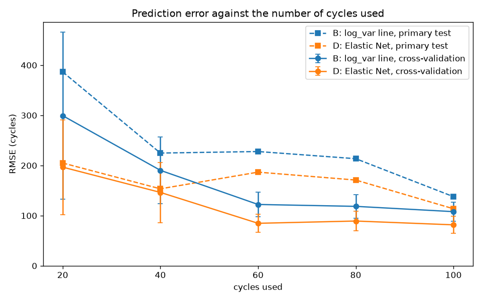

# battery-cycle-life

This project predicts how many charge cycles a lithium-ion cell will last, using only its first 100 cycles. I reproduce the paper's simplest model on public lab data, try a bigger one, and test both on a batch of cells that was cycled a year later.

Try it: [battery-cycle-life.streamlit.app](https://battery-cycle-life.streamlit.app/). Pick a cell and compare both models with how long it really lasted.

## The problem

A cell counts as worn out once it has lost 20% of its capacity. In this data that takes anywhere from 148 to 2,237 cycles, so a test that runs to the end can take a long time. A good guess after 100 cycles would save most of it.

The catch is that at cycle 100 most cells still look alike. On the training cells, capacity at cycle 100 has a correlation of only 0.47 with log cycle life, and 81% of all cells have a little more capacity at cycle 100 than at cycle 2.


## Data

The data is from Severson et al. (2019): commercial LFP/graphite cells (A123, 1.1 Ah), each fast-charged with a different policy. The raw files hold 140 cells. Following the authors' own loading notebook, I merge 5 cells that kept cycling in a second batch and drop 16, which leaves the paper's 124 (notebook 04). The split is also the paper's: 41 training cells and 43 primary test cells from batches 1 and 2, and 40 cells from batch 3, which was run a year later with a changed setup.

## Models

Both models use only the first 100 cycles and predict log10 of the cycle life.

The paper's main idea is ΔQ(V): the discharge curve at cycle 100 minus the one at cycle 10, on a fixed voltage grid. Cells that will die early already show a deeper dip in it. The log10 of its variance has a correlation of -0.90 with log cycle life on the training cells. The first model is a straight line on that one number, as in the paper.

The second model adds five simple values from the per-cycle summary: capacity at cycle 2, the early rise in capacity, the change in resistance, the charge time and the temperature. It is an Elastic Net, picked with repeated cross-validation on the training cells only. Tests make sure no feature reads anything after cycle 100.

## Results

RMSE in cycles. The first column is cross-validation on the training cells. The test sets were only used after both models were fixed.

| Model | Training cells (CV) | Primary test | Later batch |
|---|---|---|---|
| Predict the mean life | 297 | 393 | 470 |
| Line on log var(ΔQ) | 108 | 138 | 196 |
| Elastic Net, 6 features | 82 | 114 | 209 to 262 |
| Paper, same line | | 138 | 196 |
| Paper, full model | | 100 | 214 |

The line matches the paper's numbers, which tells me the data pipeline is right.

On the primary test set the Elastic Net is 24 cycles better than the line (95% range of the difference: 8 to 36). On the later batch it is worse in every run I tried, by 13 to 67 cycles. The range comes from a random seed in the Elastic Net's own inner cross-validation (notebook 11). It also predicts most of those cells too short.

The reason is that batch 3 looks different in the extra features. All 40 of its cells start with less capacity than the median training cell, and 36 of them charge in under 10.5 minutes. In batches 1 and 2, charging that fast went with a short life (median 489 cycles). In batch 3 the median life is 964. The ΔQ feature carries over to the new batch, but the extra features don't. The paper's own bigger model shows the same flip.

So for new cells from the same setup I would use the Elastic Net, and for cells from a setup the models haven't seen, the line.

## How early can it predict?



The same two models, given only the first 20, 40, 60, 80 or 100 cycles (notebook 10). In cross-validation the error stops falling at about 60 cycles: the Elastic Net is at 85 cycles with 60 cycles of data and at 82 with 100. On the primary test set, 60 and 80 cycles look worse (187 and 171), but that comes almost entirely from one long-lived cell whose ΔQ is outside anything in the training data. On the other 40 test cells the error is 76, 72 and 76 at 60, 80 and 100 cycles. So 60 cycles seem enough for typical cells but not for the ones that live very long. There are only three such cells in the test set, so I'd want more data before relying on it.

## Limitations

- The data is small. With 43 test cells, the line's test RMSE could be anywhere from about 92 to 191, so I compared models with cross-validation and not on the test set.
- That cross-validation mixes batches 1 and 2, so it couldn't see the batch 3 problem coming. Training on one of those batches and checking on the other gives a mixed answer: the Elastic Net wins one way (102 against 158) and loses badly the other (606 against 416).
- Cells that never reached 80% capacity are left out because their life is unknown, so there are no very long-lived cells that were still running when the test ended.
- Four batch 3 cells are dropped only because the paper calls them noisy. Only one of them looks noisy to me.
- Both models struggle with cells that live past 1,500 cycles. Only one training cell is in that range.

## How to run

Python 3.13:

```bash
python3.13 -m venv .venv
source .venv/bin/activate
pip install -r requirements.txt
```

The app and the tests run straight after cloning. The app reads a 1.8 MB bundle in `app_data/` and the two saved models in `models/`. The tests use made-up data and those committed files:

```bash
streamlit run app.py
pytest
```

To rerun the analysis, download the raw data (about 8.3 GB from data.matr.io) and run the notebooks in order, 01 to 11:

```bash
./scripts/download_data.sh
```

`scripts/save_models.py` and `scripts/make_app_data.py` rebuild `models/` and `app_data/` from the notebook tables.

## Layout

- `notebooks/` the analysis, in the order I did it
- `src/` shared code: reading the raw files, features, the model recipe, the paper's split
- `tests/` look-ahead checks, the model code, and the app bundle
- `app.py`, `app_data/`, `models/` the app and what it needs
- `reports/` result tables and figures
- `scripts/` download, saving the models, building the app bundle

## Data and credits

- Severson, Attia et al., "Data-driven prediction of battery cycle life before capacity degradation", Nature Energy 4, 383-391 (2019). Data from data.matr.io; check the terms there before reusing it.
- Which cells to merge and drop follows the authors' loading notebook (github.com/rdbraatz/data-driven-prediction-of-battery-cycle-life-before-capacity-degradation).
- The train and test cell lists in `src/split.py` come from Microsoft's BatteryML (MIT license).
- The paper's numbers in the results table are as quoted in Attia et al. (2021), arXiv 2101.01885.
